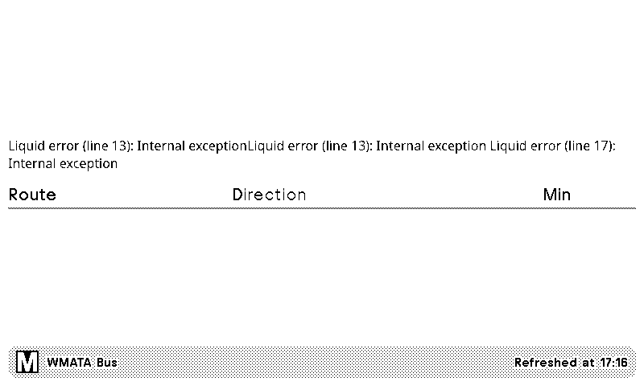

# WMATA Bus — TRMNL / LaraPaper Recipe

A custom recipe for a self-hosted [LaraPaper](https://github.com/usetrmnl/larapaper) instance
(or official TRMNL) that shows a combined bus arrival board for **any set of WMATA bus stops**,
merged and sorted by arrival time — not tied to one specific station. Configure a
comma-separated list of StopIDs (one per physical stop/bay; works with any number, including
just one).

Originally built for the three Metrobus routes/bays at Bethesda Station (D96, M22, M70), which
remains the default example, but works for any WMATA Metrobus stop.

Importable via LaraPaper's **Plugins → Import → Import Recipe Archive**, or as a base for a
[community recipe catalog](https://github.com/bnussbau/trmnl-recipe-catalog) submission.

## Setup

- **WMATA API key**: free signup at [developer.wmata.com](https://developer.wmata.com/).
- **Stop IDs**: comma-separated, e.g. `2001227,2001249,2002634`. Find yours via
  [api.wmata.com/Bus.svc/json/jStops](https://developer.wmata.com/) (search by lat/lon) or the
  WMATA trip planner.
- **Title text**: optional, defaults to "WMATA Bus" — customize to identify the location if
  you're running more than one instance (e.g. one board per stop you care about).

No field in `settings.yml` contains a real credential — they're Liquid placeholders
(`{{ field_name }}`) resolved from your own saved configuration values at render time.

## How it works

Fetches an arbitrary number of stop IDs via LaraPaper's multi-URL `polling_url` support — a
Liquid `` loop over the comma-separated `stop_ids` field generates one URL per stop,
newline-separated, which LaraPaper fetches in parallel and merges into `data.IDX_0`,
`data.IDX_1`, etc. (dynamic bracket-notation lookup, `data[key]`, works fine in this Liquid
engine — just don't seed an array accumulator with `"" | split: ","` before concatenating onto
it, since that produces `[""]` rather than a true empty array, and silently corrupts `sort` once
real data is concatenated onto it).

**Gotcha**: LaraPaper's own polling logic silently *unwraps* the response when there's only one
URL — `data` becomes the raw single-stop response directly (`data.Predictions`) instead of the
wrapped `data.IDX_0.Predictions` shape used for 2+ stops. The template checks `stops.size == 1`
and branches accordingly; skipping this check works fine with multiple stops configured but
throws a Liquid "Internal exception" the moment someone configures just one.

**Second gotcha**: if you *change* `stop_ids` (e.g. from one stop to three, or vice versa) via
the settings UI, the screen can briefly show that same error — LaraPaper's cache-staleness check
is purely time-based (`refresh_interval`/`data_stale_minutes`), not aware that a config change
invalidated the previously-cached response's shape. It resolves itself on the next natural
refetch (within `refresh_interval`, 15 min by default), but there's no way for the recipe itself
to force an immediate one from within Liquid.

## Note on WMATA coverage

WMATA's own bus API only covers Metrobus routes. Other buses you might associate with a given
area (e.g. Montgomery County Ride On near Bethesda) are a different transit agency entirely and
aren't in this data.

## Authorship

This recipe was authored with [Claude Code](https://claude.com/claude-code), working through
LaraPaper's actual database and container to build, test, and debug it against live data before
exporting it here. Originally part of a larger multi-recipe repo
([AndreMessier/trmnl-recipes](https://github.com/AndreMessier/trmnl-recipes)), split out into
its own repo to keep the WMATA and Plex recipes independently versioned.
